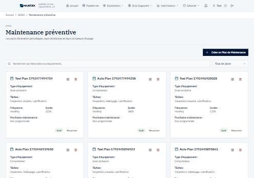

# GMAO — audit et proposition de refonte

**Date :** 20 octobre 2026
**Étape :** 1 sur 2 — audit et proposition. **Aucune modification structurelle n'a été
faite.** L'implémentation attend votre validation.
**Maquettes :** canevas « GMAO Maintrix — audit et refonte proposée »
(4 planches : vue d'ensemble proposée, l'écran aujourd'hui, l'organisation en six
domaines, les constats mesurés).

**Méthode :** lecture du code, puis mesure sur l'instance réelle — serveur lancé depuis le
bundle, base PostgreSQL de test, locataire Alpha authentifié, **143 équipements et
26 ordres de travail réels**. Chaque chiffre de ce document a été relevé, pas estimé.

---

## 1. Ce qui se passe quand on ouvre la GMAO

Un responsable de maintenance ouvre `/gmao` le 20 octobre 2026. Voici ce que l'écran lui
dit, et ce que contient la base au même instant :

| L'écran affiche | La base contient |
|---|---|
| **Ordres de travail : 0** | **26 ordres en attente**, aucun affecté |
| **« Aucune urgence, aucun retard, aucun seuil franchi. Le parc tourne. »** | 26 interventions sans technicien ni date |

**Cause.** Le compteur en haut d'écran s'appelle « Ordres de travail » mais ne compte que
`status = 'in_progress'` (`gmao-storage.ts`, `getDashboardKPIs`) — les interventions déjà
démarrées. Et le bloc « À traiter » ne liste que l'urgent, le retard, les seuils franchis
et les indisponibilités : **un ordre simplement en attente n'y a aucune ligne**. Les deux
omissions se composent, et le cockpit affirme qu'il n'y a rien à faire.

*Ce bloc « À traiter » est celui que j'ai écrit à l'étape B. L'omission est de mon fait.*

---

## 2. Inventaire

### 2.1 Structure

| Niveau | Contenu | Nombre |
|---|---|---|
| Onglets principaux | Vue d'ensemble, Ordres de travail, Équipements, Inventaire, Alertes | **5** |
| Sous-onglets, derrière le bouton « Plus » | Maintenance préventive, Historique, Achats, Rapports, Analytiques, Santé des équipements, Validation multi-niveaux, Configuration de l'entreprise | **8** |
| Tuiles de modules sur la vue d'ensemble | Exploitation (6), Analyse (6), Conformité et partenaires (6), Données et échanges (3) | **21** |
| Composants montés | voir 2.2 | **13** |
| Lignes de code derrière la page | `gmao-dashboard.tsx` (1 233) + ses composants (7 452) | **8 685** |

**41 destinations** sont atteignables depuis cette seule page.

### 2.2 Composants montés

`work-order-management` (820 l.), `equipment-management` (682), `inventory-simple` (683),
`preventive-maintenance` (909), `maintenance-reports` (1 062), `history-management` (501),
`procurement-dashboard` (370), `validation-dashboard-simple` (456),
`purchase-order-workflow-demo` (231), `purchase-order-creator` (468),
`equipment-health-dashboard` (471), `threshold-configuration` (256),
`company-letterhead-config` (543).

### 2.3 Mesures sur la vue d'ensemble

| Mesure | Valeur |
|---|---|
| Mots affichés | 246 |
| Liens cliquables | 33, pour **28 destinations distinctes** |
| Boutons visibles | 17 |
| Hauteur | **3,2 écrans** de défilement |
| **Liens qui restent dans la GMAO** | **0 sur 24** |

L'accueil n'est pas un poste de travail : **c'est une table d'aiguillage**. Et 5 des
24 tuiles renvoient vers ce qui existe déjà en onglet — Équipements, Ordres de travail,
Alertes, Inventaire, Plan de maintenance — mais vers une *autre* implémentation.

---

## 3. Le même métier, deux implémentations

Quatre domaines existent en double : une fois comme onglet, une fois comme page autonome.
Ce ne sont pas deux vues du même code, mais **deux codes différents**.

### 3.1 Ordres de travail — les capacités divergent

| Capacité | Onglet GMAO | Page `/work-orders` |
|---|---|---|
| Recherche texte | oui | oui |
| Filtre par statut | oui | oui |
| Créer, modifier | oui | oui |
| **Supprimer** | **oui** | non |
| **Créer un équipement sans quitter le formulaire** | **oui** | non |
| **Filtrer par priorité** | non | **oui** |
| **Démarrer / suspendre / terminer** | non | **oui** |
| **Choisir le technicien dans la liste des comptes** | non | **oui** |
| **Écart de compétence et demande de formation** | non | **oui** |
| **Suggestion de transition de cycle de vie** | non | **oui** |
| **Lien vers l'exécution terrain** | non | **oui** |

Le même objet métier offre des opérations différentes selon la porte empruntée. Une
correction appliquée d'un côté n'atteint pas l'autre.

### 3.2 Le préventif — deux tables, trois écrans

| Écran | Lignes | Point d'API | Table |
|---|---|---|---|
| GMAO › Plus › Maintenance préventive | 909 | `/api/preventive-maintenance-plans` | `preventive_maintenance_plans` |
| Page `/preventive-maintenance` | 1 172 | `/api/maintenance-plans` | `maintenance_plans` |
| Page `/maintenance-plan` | 378 | `/api/maintenance-plans` | `maintenance_plans` |

**Mesuré sur le même locataire, au même instant :**

```
preventive_maintenance_plans  →  12 plans
maintenance_plans             →   0 plan
```

Un plan créé d'un côté est invisible de l'autre. Ce n'est pas une duplication d'affichage :
ce sont **deux jeux de données parallèles pour la même notion métier**.

### 3.3 Et cinq plans fabriqués comblent le vide

`client/src/pages/preventive-maintenance.tsx` ligne 112 :

```js
// Sample static data for demo
const staticPlans: MaintenancePlan[] = [ … ];
…
const allPlans = [...formattedPlans, ...staticPlans];
```

Cinq plans entièrement inventés — **concaténés aux vrais**, donc toujours affichés, quelle
que soit l'organisation :

| Inventé | Valeurs |
|---|---|
| Techniciens | Jean Dupont, Marie Martin, Pierre Durand, Sophie Blanc, Michel Leroy |
| Coûts | 150 €, 280 €, 450 €, 50 €, 800 € |
| Taux de réalisation | 98 %, 85 %, 92 %, 100 %, 95 % |

C'est ce qui produit le « 5 plans · 94 % de réalisation » qu'affiche l'écran alors que
l'API renvoie **zéro**. Cela contrevient directement à la règle « ne pas introduire de
données fictives dans les vues opérationnelles ».

---

## 4. Actions inopérantes et contenus internes

**Le bouton « Supprimer » d'un équipement ne peut pas fonctionner.** Il appelle
`DELETE /api/equipment/:id` ; cette route n'existe pas. Mesuré : 404 pour le technicien
comme pour l'administrateur. L'utilisateur reçoit le message brut du routeur —
`Route API inconnue : DELETE /api/equipment/42` — un texte interne exposé tel quel.

*`apiRequest` lève bien sur un statut d'erreur : l'utilisateur voit une erreur, pas un faux
succès. Le défaut est que le bouton ne marche jamais, pas qu'il mente.*

---

## 5. Rôles, permissions et workflows

### 5.1 Un RBAC complet, monté nulle part

`client/src/hooks/use-permissions.ts` déclare **39 permissions** granulaires
(`delete_work_orders`, `validate_work_orders`, `manage_inventory`, `manage_settings`…), et
trois composants existent pour les appliquer : `Can`, `ProtectedRoute`,
`RoleBasedNavigation`.

**Aucun des trois n'est monté nulle part.** Ni `gmao-dashboard.tsx` ni aucun de ses
13 composants ne consulte un rôle — vérifié fichier par fichier.

### 5.2 Ce n'est pas une faille — c'est une promesse creuse

Vérifié sur l'instance, avec jeton CSRF valide et identifiant inexistant pour distinguer un
refus d'autorisation (403) d'une absence (404) :

| Opération | Technicien | Administrateur | Lecture |
|---|---|---|---|
| Supprimer un ordre de travail | **403** | 404 | le serveur contrôle bien le rôle |
| Supprimer un équipement | 404 | 404 | la route n'existe pas (cf. §4) |

Le serveur reste donc l'autorité, et il tranche. Le défaut est ergonomique : **on montre à
un technicien des boutons que le serveur refusera**, et on lui laisse découvrir le refus
après coup.

> **Note de méthode.** Mon premier relevé concluait que le rôle était contrôlé partout. Il
> était faux : les 403 venaient du CSRF, pas du rôle — l'administrateur les recevait aussi.
> Le jeton CSRF est un *cookie* posé à la connexion, pas une route. Sans ce contrôle en
> miroir sur un compte privilégié, j'aurais livré une fausse assurance.

### 5.3 Workflows — aucun n'est en cause

La validation multi-niveaux des bons de commande, la création d'ordre, la transition de
cycle de vie et le contrôle qualité fonctionnent et gardent leurs règles. La refonte ne les
touche pas.

---

## 6. L'information, triée

| Nature | Sur l'accueil aujourd'hui | Devient |
|---|---|---|
| **Essentiel** | « À traiter », les quatre compteurs, les derniers ordres | Reste, remonte, et s'ouvre sur la **file de travail** — l'écran doit dire quoi affecter |
| **Secondaire** | Activité sur douze mois, répartition du parc par type, indicateurs de maintenance | Descend dans l'onglet **Indicateurs** |
| **Redondant** | 5 tuiles menant à ce qui existe déjà en onglet | Disparaît : l'onglet est le chemin |
| **Inutilement visible** | 19 autres tuiles (OEE, AMDEC, étalonnages, garanties, portail client, intégrations…) | Rejoint la barre de navigation, où ces écrans figurent déjà |
| **Faux** | « Ordres de travail : 0 » et « le parc tourne » | Corrigé : le compteur devient « En attente », et « À traiter » gagne sa ligne |

---

## 7. Organisation proposée — six domaines

| # | Domaine | Ce qu'il réunit |
|---|---|---|
| 1 | **Vue d'ensemble** | À traiter · charge du moment · file de travail |
| 2 | **Actifs** | Équipements · santé des machines · cycle de vie · codes QR · capteurs |
| 3 | **Ordres de travail** | Liste et affectation · exécution terrain · alertes · permis de travail |
| 4 | **Planification** | Plans préventifs · plan annuel · étalonnages · habilitations |
| 5 | **Stocks** | Inventaire · achats · fournisseurs · garanties · validation |
| 6 | **Indicateurs** | Rapports · analytiques · historique · OEE, causes racines, AMDEC · budget |

Les 13 destinations actuelles et les 21 tuiles trouvent toutes leur place. Le niveau caché
« Plus » disparaît : on passe de **trois niveaux de navigation à deux**.

### Trois principes

1. **Une implémentation par domaine.** L'onglet monte le composant de la page, comme le
   font déjà Équipements et Inventaire. **L'union des capacités est conservée** : la
   suppression et la création d'équipement en ligne de l'onglet rejoignent le filtre par
   priorité, les transitions de statut, les techniciens, l'écart de compétence et le lien
   vers l'exécution de la page.
2. **Les rôles deviennent visibles.** Le RBAC existant est branché là où il évite une
   promesse creuse. Le serveur reste seul juge.
3. **L'accueil ne renvoie plus ailleurs.** Ses 7 destinations restent dans la GMAO.

---

## 8. Ce que la refonte ne touche pas

- **Aucun contrat d'API** : mêmes points, mêmes charges utiles.
- **Aucun workflow métier.**
- **Aucune autorisation serveur.**
- **Aucune suppression de fonctionnalité** : les 13 composants restent montés.
- **Aucun algorithme industriel.**
- **Aucun retour du thème sombre.**

---

## 9. Deux points qui demandent votre arbitrage

1. **Le préventif à deux tables.** Fusionner `preventive_maintenance_plans` et
   `maintenance_plans` touche la base et le serveur — hors du périmètre frontend, et une
   autre session travaille sur ces fichiers. Trois options : *(a)* ne garder qu'un écran
   côté interface, celui qui lit la table réellement alimentée ; *(b)* garder les deux en
   indiquant à l'écran laquelle est consultée ; *(c)* ouvrir un chantier serveur de fusion.
   **Je recommande (a)** pour cette refonte, et (c) comme chantier séparé.
2. **Les ordres de travail en cartes ou en tableau.** Le cahier des charges demande des
   tableaux triables ; les techniciens travaillent aujourd'hui sur des cartes. La maquette
   propose un **tableau** pour la file de travail de l'accueil, et laisse l'onglet en
   cartes. À confirmer.

*Les cinq plans fabriqués partent dans tous les cas : ils ne demandent pas d'arbitrage.*

---

## 10. Plan d'implémentation, après validation

| Lot | Contenu | Risque |
|---|---|---|
| 1 | Corriger le compteur et « À traiter » — la contradiction de la §1 | faible, isolé |
| 2 | Retirer les cinq plans fabriqués | faible |
| 3 | Réorganiser en six domaines, sans toucher aux composants | moyen, réversible |
| 4 | Unifier les quatre domaines dupliqués, capacités réunies | **le plus sensible** — un lot par domaine, vérifié à l'écran |
| 5 | Brancher le RBAC existant sur les actions sensibles | faible |
| 6 | Retirer le bouton inopérant, ou créer la route serveur manquante | à arbitrer |

Chaque lot est un commit isolé, vérifiable à l'écran et réversible seul. Les tests de
non-régression, d'accessibilité et de navigation s'exécutent à chaque lot, comme aux étapes
précédentes.

---

## 11. Lots 1 et 2 — faits le 20 octobre 2026

Seuls les deux lots demandés ont été traités. **La réorganisation en six domaines n'a pas
été engagée.**

### Lot 1 — le compteur contradictoire

| | Avant | Après |
|---|---|---|
| Tuile en haut d'écran | « Ordres de travail : **0** » | « Ordres ouverts : **26** » |
| Ce qu'elle compte | `in_progress` seulement | `pending` + `in_progress` |
| « À traiter » | « Aucune urgence, aucun retard. Le parc tourne. » | « **26 ordre(s) de travail à affecter** » |

Vérifié sur l'instance : la base contient 26 en attente et 0 en cours, la tuile affiche 26,
et la mention « Le parc tourne » a disparu. Le même défaut existait sur l'écran
d'ingénierie de maintenance — corrigé à l'identique.

### Lot 2 — les plans fabriqués

Les cinq plans de `pages/preventive-maintenance.tsx` sont retirés, avec leurs cinq
techniciens nommés, leurs cinq coûts et leurs cinq taux de réalisation. L'écran affiche
désormais **0 plan**, ce que contient réellement la table, avec un état vide qui explique
ce qu'est un plan préventif.

Deux conséquences traitées au passage :

- **`Math.round(0 / 0)` donnait `NaN`** : l'écran aurait affiché « NaN % ». Le défaut était
  masqué par les plans fabriqués, qui garantissaient un dénominateur non nul. Une moyenne
  sans population vaut désormais « — ».
- **Le garde-fou écrit pour ce lot a trouvé les mêmes techniciens inventés ailleurs**, sur
  l'écran Perception IoT : un « Classement des Techniciens » listant Jean Dupont, Marie
  Martin et Pierre Durand avec leurs points et leurs niveaux, et un sélecteur proposant
  trois employés à matricules inventés (MAT001 à MAT003) qui pilotait pourtant les requêtes
  de compétences. Le classement est remplacé par un état explicite ; le sélecteur liste les
  comptes réels de l'organisation.

### Trois constats qui appellent une décision serveur

Ils sont hors du périmètre frontend et une autre session travaille sur ces fichiers.

1. **`/api/gamification/leaderboard` est un faux.** Son code porte le commentaire
   « Mock leaderboard data » et renvoie les mêmes trois personnes inventées. Brancher
   l'écran dessus n'aurait rien changé.
2. **Le rang d'un technicien est tiré au sort.**
   `server/integrations/gamification-engine.ts` :
   `position: Math.floor(Math.random() * 20) + 1, // Mock position`. Vérifié par trois
   requêtes successives sur le même compte : **12, 13, 11**. Un nombre qui change à chaque
   affichage paraît vivant — c'est pire qu'une constante. La tuile qui l'affichait est
   retirée côté interface ; la route reste à traiter.
3. ~~**Le préventif à deux tables**~~ — **tranché le 20/10/2026, option (a). Voir §12.**

---

## 12. Le préventif à deux tables — option (a), 20 octobre 2026

Décision de l'utilisateur : **ne garder côté interface que l'écran qui lit la table
réellement alimentée.**

### Laquelle, et pourquoi pas sur le comptage

Un comptage sur un seul locataire de test ne prouve rien : `maintenance_plans` pourrait
être vide ici et pleine ailleurs. Le critère retenu est **l'intégration au reste du
système**, qui ne dépend pas du jeu de données :

| | `preventive_maintenance_plans` | `maintenance_plans` |
|---|---|---|
| Fichiers serveur la référençant | **6** | 4 |
| Occurrences | **45** | 12 |
| « À traiter » de la GMAO (`preventifEnRetard`, `preventifSous7Jours`) | **oui** | non |
| Agents fonctionnels (`overdue_pm`) | **oui** | non |
| Import / export de données | **oui** | non |
| Générateur de données de test | **oui** | non |
| Quelque chose au-delà de sa propre CRUD | **oui** | **non** |

`maintenance_plans` est un îlot : sa table, ses routes, ses deux écrans, et rien qui la
relie au tableau de bord, aux agents ou aux imports. Ce qu'un client importe atterrit dans
l'autre.

**Ce qui tranche définitivement :** le bloc « À traiter » comptait les préventifs en retard
dans `preventive_maintenance_plans`, puis renvoyait l'utilisateur vers `/maintenance-plan`,
qui lit `maintenance_plans`. On cliquait sur « 3 préventifs en retard » et on arrivait sur
une liste vide. Ce parcours est réparé par la même décision.

### Ce qui a été fait

- **`client/src/pages/preventive.tsx`** (nouveau) monte le composant qui lit la table
  alimentée, dans le gabarit commun, avec titre et fil d'Ariane.
- **`/preventive`, `/preventive-maintenance` et `/maintenance-plan`** mènent toutes les
  trois à cet écran. Les signets continuent de fonctionner.
- Le sous-onglet « Maintenance préventive » de la GMAO monte **le même composant**, avec
  son propre en-tête. Une implémentation, deux points de montage.
- **`pages/preventive-maintenance.tsx` (1 172 l.) et `pages/maintenance-plan.tsx`
  (378 l.) sont supprimées.**

### Analyse d'impact — ce qui est perdu, et ce qui ne l'est pas

| Capacité | Écran conservé | Pages retirées |
|---|---|---|
| Créer, modifier, supprimer un plan | oui | oui |
| Recherche | **oui** | `/maintenance-plan` : non |
| Filtre par statut | **oui** | `/maintenance-plan` : non |
| Compteurs d'usage (heures, cycles) | **oui** | `/maintenance-plan` : non |
| Calendrier, année fiscale | oui | oui |
| Onglet « Analyses » | non | `/preventive-maintenance` seulement |
| Statistiques dédiées | non | `/maintenance-plan` seulement |

Les deux capacités perdues portaient sur la table vide. L'onglet « Analyses » portait de
surcroît, dans son propre code, la mention « Cet export fabriquait ses chiffres » — une
campagne précédente l'avait déjà neutralisé.

### Vérification




Mesuré après reconstruction : les trois routes servent le même écran, avec un seul `<h1>`
« Maintenance préventive », la barre de navigation, et **14 plans affichés pour 14 en
base**. L'ancien titre « Plan de Maintenance Annuel » a disparu de l'interface.

> **Note de méthode.** Ma première vérification portait sur un bundle périmé de douze
> minutes : l'écran montrait encore l'ancienne page, et j'ai failli conclure que le routage
> n'avait pas pris. Comparer l'horodatage de `dist/` à celui des sources avant de conclure
> quoi que ce soit d'une vérification au navigateur.

### Au passage : une page morte aux métriques fabriquées

`pages/maintenance-dashboard.tsx` (878 lignes) n'était importée nulle part — sa route
redirigeait vers `/gmao` depuis le 11 octobre, parce qu'elle affichait « 156 ordres de
travail, OEE 87,5 %, MTBF 720 h, 125 800 € de coûts », chiffres que son propre code
annonçait comme « Sample data ». Le garde-fou écrit pour la moyenne sans population l'a
rencontrée. Le fichier est supprimé ; la redirection reste pour les signets.

### Ce qui reste ouvert

La **fusion des deux tables** côté serveur. `maintenance_plans` existe toujours, avec ses
routes et son schéma ; plus aucun écran ne la lit. Tant qu'elle reste, un développeur peut
la rebrancher sans le savoir. C'est un chantier serveur, hors du périmètre frontend.
